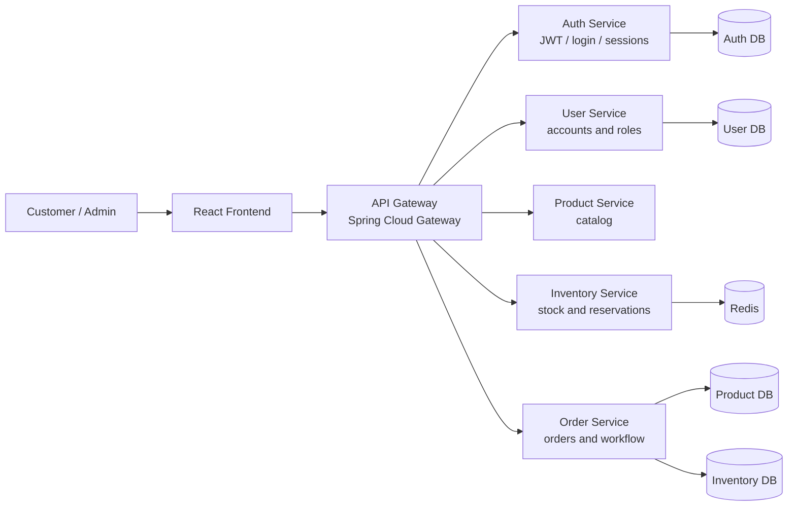
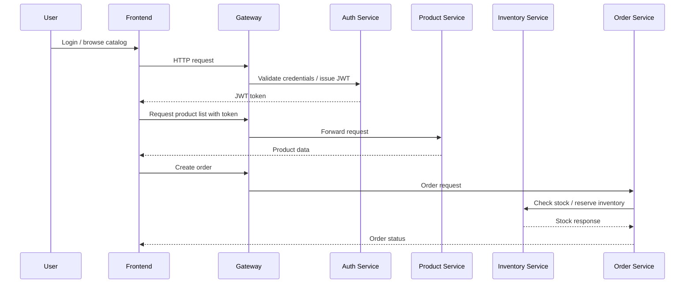
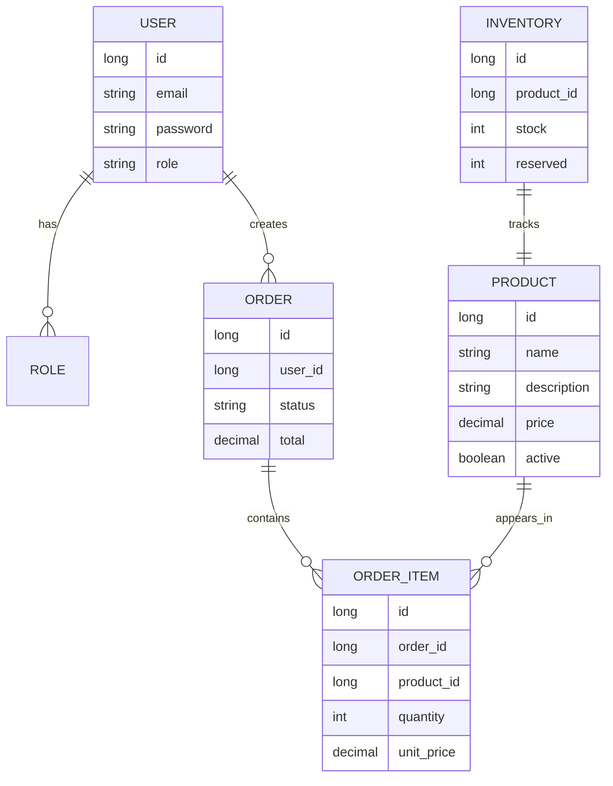

# 🚀 Distributed E-Commerce Platform

<div align="center">

  
  
  
  

</div>

> ⚠️ Status: in active development and not production-ready.

This repository contains a distributed e-commerce application built with Java, Spring Boot, React, PostgreSQL, Redis, Docker Compose, and a Spring Cloud Gateway. The project is designed as a modular platform where each business capability is isolated in its own microservice, while the frontend communicates through a single API entry point.

The goal is to demonstrate a realistic enterprise-style architecture for a digital commerce system, including JWT-based security, service decomposition, asynchronous communication patterns, and containerized local orchestration.

## 📌 Overview

The application is being developed around the following business flow:

- 🧑‍💼 User registration and authentication
- 🛍️ Product catalog browsing
- 📦 Inventory checks and reservation
- 🧾 Order creation and lifecycle management
- 🔐 Basic security through JWT and gateway filters
- 🐳 Local or containerized runtime with PostgreSQL and Redis

This project is intentionally designed as an educational and architectural prototype. Some modules are still evolving and should be considered experimental.

## 🏗️ Architecture

### High-level system view



### 🔄 Service interaction flow



## 📁 Project structure

```text
.
├── auth-service/        # 🔐 JWT-based authentication and session logic
├── user-service/        # 👤 User management and roles
├── product-service/     # 🛒 Product catalog and product data
├── inventory-service/   # 📦 Stock, reservations, and inventory operations
├── order-service/       # 🧾 Order lifecycle and orchestration
├── gateway/             # 🚪 API gateway and security filters
├── frontend/            # ⚛️ React + Vite client
├── DBs/                 # 🗄️ SQL schemas for service databases
├── docs/                # 📚 Project notes and technical references
├── docker-compose.yml   # 🐳 Local infrastructure definition
├── README.md            # 📘 Project overview
├── version.md           # 📝 Notes about current implementation details
└── .gitignore
```

## 🧰 Technology stack

### ⚙️ Backend

- ☕ Java 17/21 (runtime varies across services)
- 🌱 Spring Boot 3.x / 4.x
- 🔒 Spring Security
- 🚦 Spring Cloud Gateway
- 🗃️ Spring Data JPA
- 🧠 Redis integration
- 🪪 JWT using JJWT
- 🐘 PostgreSQL

### 🎨 Frontend

- ⚛️ React 19
- ⚡ Vite
- 🟦 TypeScript
- 🎨 Tailwind CSS
- 🧭 React Router DOM

### 🐳 Infrastructure and tooling

- 🐳 Docker
- 🧩 Docker Compose
- 🛠️ Maven
- 🧾 Git
- 🗄️ PostgreSQL and Redis containers for local orchestration

## 🧩 Core services

| Service | Responsibility | Status |
| --- | --- | --- |
| `gateway` | 🚪 Single entry point, routing, JWT validation, security filters | In progress |
| `auth-service` | 🔐 Login, token generation, security sessions, user authentication | In progress |
| `user-service` | 👤 User domain and role logic | In progress |
| `product-service` | 🛒 Catalog, product CRUD, price and metadata | In progress |
| `inventory-service` | 📦 Inventory checks, reservations, stock updates | In progress |
| `order-service` | 🧾 Order creation and order state transitions | In progress |
| `frontend` | 🖥️ Store UI and user experience | In progress |

## 🧭 Current business domains

### 🔐 Authentication and authorization

The authentication layer is built around JWT and security filters. The gateway acts as the public entry point, while the auth service issues and validates tokens. This enables protected routes and centralized request handling.

### 🛍️ Product domain

Product data is separated into its own service to keep catalog logic independent from order and inventory concerns. This helps isolate responsibilities and maintain a clean domain boundary.

### 📦 Inventory and order flows

Inventory reservations are expected to happen before an order is confirmed. The design follows a typical e-commerce lifecycle:

1. 🧑‍💻 User requests an order
2. 🧾 Order service validates the items
3. 📦 Inventory service checks available stock and reserves quantities
4. 🔄 Order status advances based on the result
5. 💳 Payment and notification flows can be integrated afterward

## 🗄️ Database and data ownership

Each service owns its own data model and database schema. This is a core microservice principle to reduce coupling.



The project includes SQL files under the `DBs/` directory, which define the database schema for the available services. These schemas reflect the early stage of the platform and may evolve as the domain model matures.

## 🧪 Local development setup

### ✅ Prerequisites

- ☕ Java 17 or 21
- 🛠️ Maven
- ⚙️ Node.js 20+
- 📦 npm
- 🐳 Docker Desktop or Docker Engine
- 🧩 Docker Compose

### 1. 🚀 Start infrastructure

```bash
docker compose up -d --build
```

This initializes the infrastructure used by the platform, including PostgreSQL and Redis.

### 2. ⚙️ Start backend services

From the project root, run the Spring Boot services individually or through your preferred IDE:

```bash
cd gateway
mvn spring-boot:run

cd ../auth-service
mvn spring-boot:run

cd ../user-service
mvn spring-boot:run

cd ../product-service
mvn spring-boot:run

cd ../inventory-service
mvn spring-boot:run

cd ../order-service
mvn spring-boot:run
```

### 3. 🎨 Start the frontend

```bash
cd frontend
npm install
npm run dev
```

The frontend will typically run on the default Vite development port, while the gateway can be reached on a port such as `8080` depending on the active configuration.

## ⚙️ Configuration notes

A few environment values are required for local development, especially for JWT and Redis connectivity. The project includes examples and notes under `docs/` and the Docker Compose configuration.

Current project behavior also includes the use of `localStorage` for session persistence during early development. This is acceptable for a prototype, but it is not a recommended production strategy for storing sensitive tokens.

---

<p align="center">
  <strong>Built for learning, architecture exploration, and distributed system design.</strong>
</p>

## Security model

The current design follows a microservice-oriented security model:

- Client authenticates through the auth service
- JWT is issued after successful login
- Gateway validates tokens before routing protected requests
- Services remain logically separated and can enforce authorization independently
- Redis and session tracking are used in support of security and request lifecycle concerns

## Current development status

This project is still under active construction. The expected evolution is:

- Phase 1: gateway + auth + user + product foundations
- Phase 2: inventory and order orchestration
- Phase 3: payment simulation and event-driven flow
- Phase 4: observability, testing, CI/CD, and deployment preparation

A few areas are intentionally still being refined, including service boundaries, runtime configuration, and final security patterns.

## Roadmap

### Near term

- Finish the Gateway routing and validation flow
- Stabilize user and auth service interactions
- Refine product and inventory service contracts
- Improve local database setup and service configuration

### Mid term

- Introduce order lifecycle rules and reservation handling
- Add asynchronous communication and event patterns
- Expand test coverage
- Improve documentation and environment configuration

### Long term

- Add production-ready monitoring and observability
- Harden authentication and session management
- Improve deployment automation for cloud environments
- Add CI/CD and quality gates

## Contribution

This repository is a learning and architecture project. Contributions are welcome, especially if they improve clarity, architecture quality, security, or development tooling.

Please keep changes aligned with the current stage of the project: functional, well-documented, and easy to reason about in a microservice context.

## License

This project currently does not define a formal license file. If a production use case is required, a license should be added before broader distribution or deployment.
